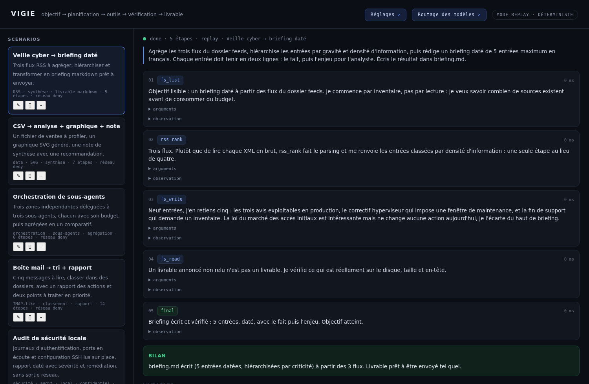
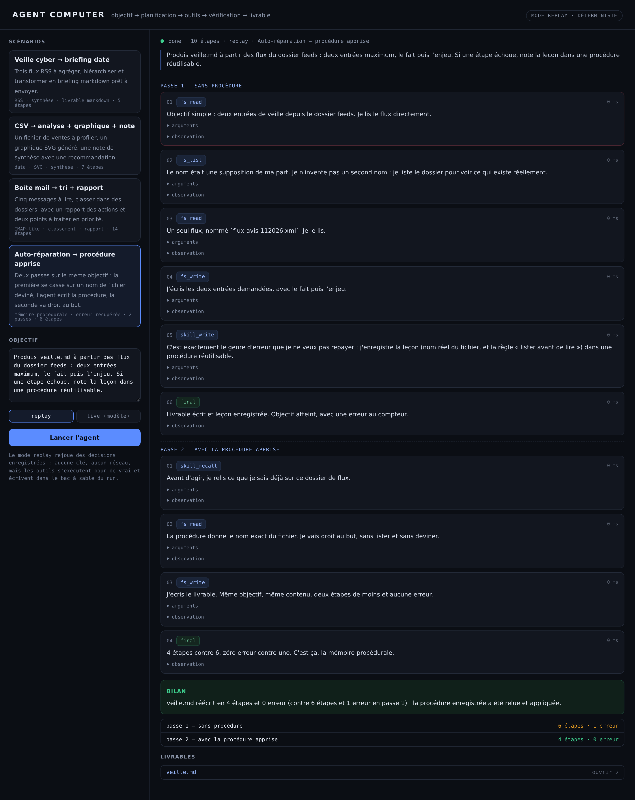
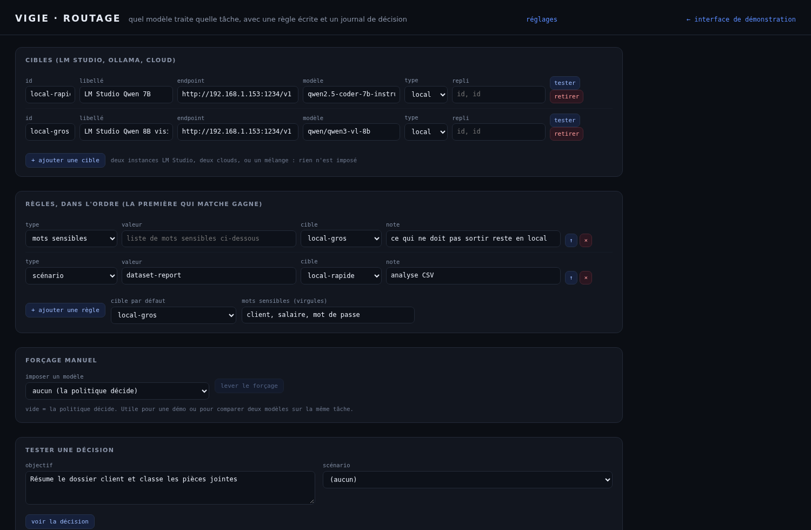
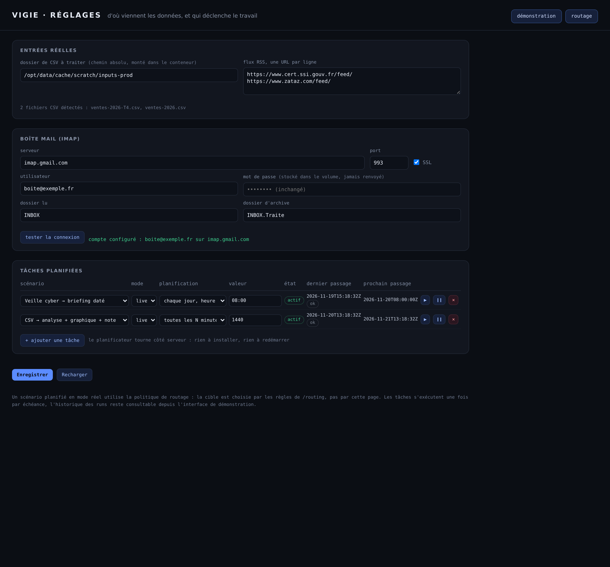

# Vigie

### The agent that takes the watch: it acts, it verifies, it learns from its mistakes.

[](https://github.com/hollow313/ASUS-Agent-Computer-Challenge---High-End/actions/workflows/docker-build.yml)


[Français](README.md) · **English**

**ASUS Agent Computer Challenge submission, High-End category.**

---

# Part 1. What it does, and why it needs compute

An agent is not a chat that answers. It is a program that receives an objective, picks tools, acts
on real files, re-reads what it produced and starts again when something breaks. The difference
between a demo and a tool is that a demo only looks like it works.

**Vigie** is a complete agent, runnable with one command, no key, no network, no GPU. It writes real
deliverables: a dated briefing, a costed summary with its chart, a triaged mailbox. It learns
procedures and re-reads them on the next run. It delegates to sub-agents with their own budget. It
picks its model per task. It runs every morning at 8 if you ask it to.

All of that runs today on a 3 GB VRAM card and a 7-billion-parameter model. That is where the
project meets its ceiling, and where the Radeon AI PRO R9700 changes the nature of the work.

## What is missing, and what the card unlocks

With 3 GB of VRAM, the largest model that fits is 7 billion parameters at 4 bits. It is fast, it is
free, and it is wrong about one task in two. The model that handles ambiguous work does not fit.
Sub-agents cannot run in parallel. Context stays short, so the agent forgets the start of the file
in the middle of the file.

32 GB of VRAM is not comfort. It is the size that holds a 32-billion-parameter model at 4-bit
quantisation (30.4 GB measured, 1.6 GB of margin for context and sub-agents), or a 14B model at 8
bits with 11 GB of margin. Such a model reads a whole file, holds a thirty-step reasoning chain, and
no longer needs the work chopped into pieces in case it loses the thread.

The measurement ships with the repository, reproducible with one command, and the limits are
written down in part 2. Nobody has to take my word for it: run the bench.

## In thirty seconds

```bash
git clone https://github.com/hollow313/ASUS-Agent-Computer-Challenge---High-End
cd ASUS-Agent-Computer-Challenge---High-End
python3 -m agentdemo scenarios                  # five scenarios, nothing to install
python3 -m agentdemo run --scenario cyber-brief # one full, deterministic run
python3 -m agentdemo serve --port 8080          # the same with the web UI
python3 -m unittest discover -s tests           # 32 tests, a quarter of a second
```

Or in a container, the same image used for every screenshot here:

```bash
docker run --rm -p 8080:8080 holloow313/asus-agent-computer-challenge-high-end:latest
```

No Python dependency, no framework, no API key. Replay mode replays recorded decisions, but the
tools really execute: files are written, the CSV is computed, the chart is generated.



## The numbers

Same 10 tasks, same prompt, temperature 0, deterministic exact-match grading. Not an opinion: a
test that passes or fails. Hardware: the 3 GB VRAM card currently in my machine.

| Target | Where | Success | p50 | p95 | Cost / 1 000 tasks |
| --- | --- | --- | --- | --- | --- |
| Qwen 2.5 Coder 7B, Q4 | local, 3 GB VRAM | 60 % | 0.40 s | 0.64 s | 0 € |
| Qwen3 VL 8B, Q4 | local, 3 GB VRAM | 90 % | 11.6 s | 28.7 s | 0 € |
| DeepSeek Chat | cloud | 100 % | 0.93 s | 1.25 s | 0.02 € |

Measured 2026-11-20 15:39 UTC, ten tasks, one pass. Raw report and JSON:
[`docs/mesures/mesures-20261120.md`](docs/mesures/mesures-20261120.md).

Three lines, one conclusion: local is free but wrong one time in two, or thirty times slower; cloud
is right but sends your data out; and the middle model that would do both does not exist in 3 GB.
That is exactly the gap the card fills.

Method, tasks, prices and raw files: [`bench/README.md`](bench/README.md) and
[`docs/comparatif-local-cloud.md`](docs/comparatif-local-cloud.md).

## Why 32 GB, computed rather than wished

```
$ python3 -m agentdemo fit --vram 32 --context 32768

model                      size         quant   memory     margin
qwen2.5-coder-7b            7.6 B           Q8    11.7 GB   20.3 GB
qwen2.5-coder-14b          14.7 B           Q8    20.9 GB   11.1 GB
mistral-small-24b          23.6 B           Q6    26.9 GB    5.1 GB
qwen2.5-coder-32b          32.8 B           Q4    30.4 GB    1.6 GB
llama-3.3-70b              70.6 B does not fit     56.0 GB  -24.0 GB
```

A 32-billion-parameter model fits at 4 bits, with 1.6 GB left for long context and sub-agents. That
is the format that changes the nature of the work: the agent stops chopping each task into pieces
it can hold, and starts reading the whole file.

The same command on 16 GB shows the 32B does not fit at all, even at Q4. The requested card is not a
whim, it is a sizing decision you can verify.

| Today (3 GB) | With 32 GB |
| --- | --- |
| 7 to 8 B at Q4, one task in two fails at times | 32 B at Q4 fully resident, 70 B possible |
| short context, truncated history | long context, whole file and a held reasoning chain |
| monitoring and mail handled in the cloud | everything stays on the machine, sensitive data included |
| personal RAG unrealistic | index over my archives, cited answers |

## What a jury can verify in ten minutes

1. **It runs.** One command, no key, five scenarios, deliverables written.
2. **The result is real.** Briefing, summary and chart are in the run sandbox, with a timestamped
   step journal and a downloadable ZIP export.
3. **The agent learns.** Run `self-repair`: pass 2 does 4 steps where pass 1 did 6, and zero errors
   instead of one. The procedure sits in `data/skills/`, readable, with its verification contract.
4. **The agent really delegates.** `delegation` spawns three sub-agents with their own budget and
   folder, then aggregates their deliverables. Verified in live mode too.
5. **The agent picks its model.** `/routing` decides which target handles which task, and every
   execution journals its decision with the reason.
6. **It is operable.** `/settings` wires a CSV folder, an IMAP account and schedules scenarios every
   morning. The password is never returned by the API.
7. **The limits are written.** Part 2 below, and [`docs/PRODUCTION.md`](docs/PRODUCTION.md).

## Two videos, two uses

| Video | Length | What it shows |
| --- | --- | --- |
| [`docs/video/agent-computer-presentation.mp4`](docs/video/agent-computer-presentation.mp4) | 2 min 25 | the whole project: the 3 GB ceiling, the five scenarios, procedural memory, delegation, routing, scheduling, the measurements and the card sizing |
| [`docs/video/agent-computer-demo.mp4`](docs/video/agent-computer-demo.mp4) | 64 s | the agentic loop in action, from objective to deliverable |

The first is the guided tour: nine slides, a continuous voice-over, the real screenshots of the
repository. The second is the short demo, for whoever wants to see the agent run before reading.
Narration script: [`video/narration-presentation.txt`](video/narration-presentation.txt); the edit
is reproducible with `video/slides3.py` then `video/build3.py`.

The voice-over of the first video is produced by a tool of the project (`tts_speak`), not by
external software. The audio file and the narration script are in the repository.

## Three projects, one submission

This repository is my High-End entry. Two other projects exist, on other trades, with the same
discipline: no dependency, a demo that runs, a verifiable result.

| Level | Project | What it does |
| --- | --- | --- |
| AI Entry | [Archiviste](https://github.com/hollow313/ASUS-Agent-Computer-Challenge---AI-Entry) | reads a local administrative folder, extracts deadlines, answers with sources, refuses out-of-scope requests |
| Developer | [RGAA Agent](https://github.com/hollow313/ASUS-Agent-Computer-Challenge---Developer) | audits a site, really patches the HTML, re-audits: 63.9 % to 100 % compliance on the demo site |

The rules allow one entry per level, so I submit one. The other two are public and runnable, and
show the same method applied to different problems.

## What I do not promise

Cost is not the argument. At 0.05 € per thousand tasks, the cloud is cheaper than the card's
electricity. An honest demo cannot sell local inference on price.

Three arguments hold:

- **sovereignty**: a client file, a letter, a family archive never leaves the machine, and that is
  checkable in the code;
- **quality parity locally**: 32 GB holds the model that is almost never wrong, which 3 GB forbids
  today;
- **availability**: the agent runs at night, no quota, no outage, no bill that climbs.

And a roadmap the hardware makes possible: a RAG over my archives, LoRA fine-tuning of a small model
on my own traces, a router driven by measured thresholds. Each step produces a publishable number.

---

# Part 2. Under the hood

## Overview

```
                 +----------------------------------------------+
   objective --->|  agent loop: plan -> tool -> observation      |
                 +------+-------------------------------+-------+
                        |                               |
        +---------------v----------+        +-----------v-------------+
        | planner                  |        | tools (sandbox)         |
        |  replay: cassette        |        |  fs_*   csv_*   rss_*   |
        |  live:   /chat/...       |        |  mail_*  chart  tts     |
        +---------------+----------+        +-----------+-------------+
                        |                               |
        +---------------v----------+        +-----------v-------------+
        | routing: which target    |        | procedural memory       |
        | for which task           |        | skills/, with contracts |
        +--------------------------+        +-------------------------+
```

One process, standard library only, no network call by default. A run lives in
`data/runs/<id>/workspace/`, writes its journal as JSON, and leaves its deliverables on disk.

## The agent cycle

One turn is one planner decision and one observation. The planner receives the objective and the
history, and returns either a tool call or a conclusion. The step budget is hard: past it the run
stops with `budget` status instead of looping.

Three guardrails came out of real runs that went sideways:

- **tolerant arguments**: a small model sometimes returns its arguments as a JSON string, they are
  decoded instead of failing the step;
- **suggested paths**: a "not found" error returns the real path of the file it looked for and the
  list of CSVs in the run, so the model corrects itself on the next turn;
- **loop breaker**: three identical failing calls stop the run as `blocked` instead of burning the
  budget.

These are not polish: they are the difference between a 7B that works and a 7B that goes in circles.

## Replay and live, one interface

- **`ReplayPlanner`**, default: replays a recorded decision trace
  (`scenarios/<slug>/cassette.json`). Deterministic, offline, no key. **Tools still execute for
  real**: the sandbox is real, the files are real. This is what a reviewer runs in thirty seconds.
- **`OpenAICompatPlanner`**: talks to any OpenAI-compatible `/chat/completions` endpoint. The model
  gets the tool catalogue in its system prompt and answers with a single JSON action.

The same scenario therefore runs in replay for a demo and in live mode to measure a model.

## The five scenarios

| Scenario | Objective given to the agent | Real deliverables |
| --- | --- | --- |
| `cyber-brief` | aggregate three feeds, rank them, write a dated briefing | `briefing.md` |
| `inbox-triage` | read 5 messages, classify by moving files, report actions | `rapport-tri.md` + `triaged/` |
| `dataset-report` | profile a CSV, draw a chart, produce a note with three findings | `synthese.md`, `graphique.svg` |
| `delegation` | delegate three zones to three sub-agents, re-read, aggregate | `comparatif.md` + 3 deliverables |
| `self-repair` | three passes on the same objective: break, learn, correct | `veille.md` + two procedure versions |

A scenario can also be created from the UI (button **new scenario**), run once in live mode, then
recorded as a cassette. The trace only holds decisions; observations are reproduced at run time by
the real tools, so replay stays honest.

## Procedural memory and its upkeep

The agent is not smarter from one run to the next, it is cheaper. A learned procedure is a JSON file
in `data/skills/` with its content, date, usage count, a verification contract and a computed
confidence.

- `skill_recall` re-reads procedures before acting;
- `skill_write` records a lesson with its contract ("the file exists and has 3 columns");
- `skill_feedback` updates confidence from success or failure;
- `skill_revise` rewrites a stale procedure and only reactivates it if the new contract passes;
- `skill_resolve` arbitrates two contradictory procedures by evidence, not by date;
- `maintenance_run` runs an upkeep pass: repair by name similarity, arbitrate, retire.

In `self-repair`, pass 2 does 4 steps and 0 errors where pass 1 did 6 with one error. The procedure
that became wrong (the file is renamed between passes) is detected by its broken contract, not by
luck.

```bash
python3 -m agentdemo skills            # registry: status, successes, uses, confidence, contract
python3 -m agentdemo maintain --once   # repair, arbitrate, retire
python3 -m agentdemo maintain --interval 300
```



## Sub-agent delegation

A sub-agent is not a function call. It has its own budget, its own journal, its own sandbox in
`delegations/<name>/`, and the parent shares nothing with it except the inventory of input files.

Two modes: if a cassette exists for that name, the sub-agent replays it; otherwise, if the run talks
to a real model, it inherits the parent endpoint and model and does the work. Depth is capped at
three levels, an already-spawned sub-agent cannot be respawned, and a sub-agent that exceeds its
budget returns its status.

```
parent (8 steps, live mode)
+-- sub-agent zone-north -> analysed deliverable
+-- sub-agent zone-west  -> analysed deliverable
+-- sub-agent zone-south -> analysed deliverable
+-- re-reads all three, then comparatif.md
```

## Model routing

An agent that talks to a single model picks the wrong tool for every task. `/routing` declares any
number of targets (two LM Studio instances, two clouds, or a mix) and ordered rules: sensitive
words, scenario, objective pattern, catch-all. The first matching rule wins, a manual override can
force any target, and every real execution journals its decision with the reason.



```bash
python3 -m agentdemo route --objective "Summarise the client file"        # local, sensitive data
python3 -m agentdemo route --objective "Analyse this dataset" --scenario dataset-report
python3 -m agentdemo route --override local-gros                         # force a target
```

Details: [`docs/ROUTAGE.md`](docs/ROUTAGE.md).

## Real inputs and scheduling

`/settings` declares the real inputs: a CSV folder (copied into `inputs/` at run start, never mounted
read-write), RSS feeds, an IMAP account with an archive folder. The password is stored 0600 on the
volume, the API returns `********` and a boolean.



Two mail tools talk to the mailbox for real, with `imaplib` from the standard library: `mail_list`
reads sender, subject, date and a snippet; `mail_move` archives a message. Without a configured
account, the tool refuses and says where to configure it. Verified against a real mailbox: 18
messages read, report written in 5 steps, no message moved during the test.

The scheduler runs inside the server process, re-reads `settings.json` on every tick and consumes
each due slot once: every day at a fixed time, or every N minutes. A task created after its time
fires once, then resumes its rhythm: the catch-up behaviour you want after an outage. Verified in a
container: due task, fired in 20 s, run produced, history kept.

```
08:00  cyber watch   -> dated briefing     (daily, fixed time)
02:00  CSV report    -> analysis + chart   (every 1440 minutes)
```

## Security and data

- per-run sandbox: any path outside the run folder, including `../`, is refused;
- network off by default (`AGENTDEMO_ALLOW_NETWORK=0`), network tools disabled unless asked;
- no deletion: triage moves files, everything is reversible;
- secrets never in the repository: a fresh clone contains no key, no address, no machine path, and
  `settings.json` / `routing.json` live on the volume;
- non-privileged container, UID 568, a single `/data` volume, no Docker socket;
- CI builds the image, starts the container, hits `/healthz`, runs a scenario and downloads the
  deliverable before publishing.

## Measure, don't claim

`bench/bench.py` runs ten exact-match tasks against any OpenAI-compatible endpoint, measures
client-side latency (p50 and p95), counts the tokens actually reported and computes a cost per
thousand executions.

```bash
python3 bench/bench.py --target "local=http://IP:1234/v1|model" --repeat 3
```

What those figures do not say, and the generated report states: the task set is short and
checkable, hence conservative; remote endpoints vary with network load; the local cost ignores the
card amortisation.

## Memory sizing

`agentdemo fit` takes VRAM, a context size and a list of models, then says what fits:
`weights = parameters x bytes per billion by quantisation + 1.5 GB runtime`. Assumptions live in
`agentdemo/fit.py`; the table above comes from the command.

## Build, run, test

```bash
python3 -m agentdemo doctor                    # pre-flight check
python3 -m agentdemo run --scenario delegation # replay, deterministic
python3 -m agentdemo serve --port 8080         # UI, /routing, /settings
python3 -m agentdemo export                    # archive of the last run
python3 -m agentdemo route --objective "..."   # routing decision
python3 -m agentdemo fit --vram 32             # sizing
python3 -m agentdemo validate                  # cross-check cassettes against tools
python3 -m unittest discover -s tests          # 32 tests
```

In a container, UID 568 must own the volume:

```bash
mkdir -p /mnt/<pool>/apps/agent-demo && chown -R 568:568 /mnt/<pool>/apps/agent-demo
docker run -d --name agentdemo -p 8080:8080 \
  -v /mnt/<pool>/apps/agent-demo:/data \
  holloow313/asus-agent-computer-challenge-high-end:latest
```

Two registries: `holloow313/...` on Docker Hub (pull without authentication) and
`ghcr.io/hollow313/...` on GHCR. Tags `latest`, `sha-*` and `v*`.

### Plugging a real model

Live mode points at any OpenAI-compatible endpoint: LM Studio, Ollama, vLLM, or a remote API. Three
fields in the UI (endpoint, model, optional key), a button that queries `/models` and fills the
list, four presets.

```bash
python3 -m agentdemo run --scenario cyber-brief --live \
  --base-url http://YOUR-IP:1234/v1 --model llama-3.1-8b
```

As environment variables, handy in a container: `AGENTDEMO_LLM_BASE_URL`, `AGENTDEMO_LLM_MODEL`,
`AGENTDEMO_LLM_API_KEY`. The `/v1` suffix is added when missing, and the error is explained instead
of returning a raw code.


## API

| Route | Method | Purpose |
| --- | --- | --- |
| `/` | GET | web UI |
| `/healthz` | GET | health probe |
| `/api/scenarios` | GET, POST | scenario list, or create one |
| `/api/scenarios/<slug>/record` | POST | record a run trace as a cassette |
| `/api/run` | POST | `{"scenario": "...", "mode": "replay live", "llm": {...}}` |
| `/api/runs/<id>` | GET | state, steps, summary, artifacts |
| `/api/runs/<id>/export` | GET | run archive: journal and deliverables |
| `/api/artifacts/<id>/<path>` | GET | download a deliverable |
| `/api/skills` | GET | learned procedures, confidence, status |
| `/api/maintenance` | GET | recent upkeep passes |
| `/api/maintenance/run` | POST | trigger an upkeep pass |
| `/api/routing` | GET, POST | routing policy |
| `/api/routing/decide` | POST | decision for an objective |
| `/api/routing/probe` | POST | query a target's `/models` |
| `/api/settings` | GET, POST | real inputs and scheduling |
| `/api/settings/test-mail` | POST | test the IMAP connection |
| `/api/jobs/<id>/run` | POST | run a scheduled task now |
| `/api/llm/models` | GET | probe an OpenAI-compatible endpoint |

## Assumed limits

- **No fine-tuning.** The agent does not learn new weights, it accumulates written procedures. A
  fine-tuned model would be better, that is not what this repository does.
- **No automatic content rewrite.** A wrong procedure is detected by its broken contract and
  retired, but its text is not rewritten by the model during upkeep.
- **Simple scheduler.** One instance, no distributed lock, one catch-up slot. For several
  instances, use an external scheduler.
- **Settings in a single file.** Two tabs saving at once overwrite each other.
- **IMAP read and move only.** No replies, no attachment processing.
- **Live mode depends on the model.** A 7B is wrong, repeats itself, invents paths. The guardrails
  absorb, they do not fix an undersized model. That is precisely the argument for the card.
- **No real IMAP in CI.** That path is checked by hand; automation covers the error cases.
- **This is not my production agent.** The real instance runs permanently on a personal server with
  about a hundred procedures, twenty scheduled tasks, a browser driven over CDP on another machine.
  It holds private data, so it is not published. This repository is the publishable version, with the
  same mechanisms.

## Repository layout

```
agentdemo/
+-- agent.py              # the loop: planning, tool, observation, summary
+-- planners.py           # deterministic replay + OpenAI-compatible endpoint
+-- tools.py              # sandbox tools, delegation, memory
+-- skills.py             # procedural memory: contracts, confidence, revision, arbitration
+-- maintenance.py        # upkeep: repair, arbitrate, retire
+-- routing.py            # routing policy: targets, rules, override, history
+-- settings_store.py     # real inputs and scheduling (password never returned)
+-- mailbox.py            # real IMAP read and triage (imaplib)
+-- fit.py                # memory sizing: what fits on a card
+-- doctor.py             # install diagnostics
+-- export.py             # run archive: journal, deliverables, summary
+-- scenarios_loader.py   # scenarios, cassettes and fixtures loading
+-- cli.py                # CLI: run, serve, doctor, export, fit, skills, maintain, validate, new
+-- server.py             # HTTP API, web UI and scheduler (http.server)
+-- web/index.html        # single-page UI, no dependency
+-- web/routing.html      # routing configuration page
+-- web/settings.html     # operations page: inputs, IMAP, scheduling
+-- scenarios/            # cyber-brief, inbox-triage, dataset-report, delegation, self-repair
tests/test_demo.py        # 32 tests: scenarios, procedures, delegation, sandbox
bench/                    # measurement bench: tasks, prices, simulated endpoint
video/                    # title cards, UI capture and narration script
docs/                     # screenshots, architecture, comparison, scenarios, 3-minute path
```

## Adding a scenario

```bash
python3 -m agentdemo new --slug invoice-triage --title "Invoice triage" \
  --objective "Classify invoices from inbox and write rapport.md."
python3 -m agentdemo validate --slug invoice-triage
python3 -m agentdemo run --scenario invoice-triage
```

A scenario is a folder with `scenario.json`, `cassette.json` (one action per step, `args` keys
matching the tool signature exactly) and `fixtures/`. `validate` cross-checks cassettes against the
real tools: unknown tool, missing or extra argument, missing conclusion. Full format:
[`docs/SCENARIOS.md`](docs/SCENARIOS.md). Three-minute path for a busy reviewer:
[`docs/DEMO.md`](docs/DEMO.md).

## Licence and author

MIT, see `LICENSE`. Author: Loïc Huon.
