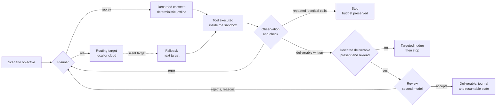

[Français](README.md) · [**English**](README.en.md)

# Vigie

**An agent that stands the watch 24 hours a day.** It receives an objective, picks its tools, writes
files, re-reads what it produced, learns from its mistakes and resumes its work after a crash.

[Watch the presentation](https://youtu.be/YmQbnhEh1Ps) · [30-second demo](#in-thirty-seconds) · [The numbers](#the-measured-numbers) · [The limits](#limits-we-accept)


**ASUS Agent Computer Challenge, High-End category.** Vigie is the distributable version of the agent that has been running on my machine for months; this repository publishes its core, without my data and without my keys.

## Contents

- [In thirty seconds](#in-thirty-seconds)
- [What the agent does](#what-the-agent-does)
- [What the card unlocks](#what-the-card-unlocks)
- [The measured numbers](#the-measured-numbers)
- [Seven scenarios, seven deliverables](#seven-scenarios-seven-deliverables)
- [A real case, on the internet](#a-real-case-on-the-internet)
- [Architecture and loop](#architecture-and-loop)
- [Robustness: fallback, resume, review](#robustness-fallback-resume-review-approvals)
- [Security and data](#security-and-data)
- [Limits we accept](#limits-we-accept)
- [Build, test, extend](#build-test-extend)

## In thirty seconds

```bash
git clone https://github.com/hollow313/ASUS-Agent-Computer-Challenge---High-End
cd ASUS-Agent-Computer-Challenge---High-End
python3 -m agentdemo scenarios                  # the seven scenarios
python3 -m agentdemo run --scenario cyber-brief # one full, deterministic run
python3 -m agentdemo serve --port 8080          # the same thing with the interface
python3 -m unittest discover -s tests           # 64 tests, three seconds
```

### ▶ The presentation on video

[](https://youtu.be/YmQbnhEh1Ps)

*Click the image to play the video on YouTube (2 min 25).*

It shows the seven scenarios, procedural memory, delegation, routing with
fallback, crash resume, the second-model review, manual approval and the card sizing. The short demo,
1 min 03, is online too: [youtu.be/rUKwZeVePNs](https://youtu.be/rUKwZeVePNs). The file also lives in the
repository: [`docs/video/vigie-presentation.mp4`](docs/video/vigie-presentation.mp4).

No dependency, no key, no network access: replay mode plays recorded decisions, but the tools really
run. Files are written, the CSV is computed, the chart is generated.

```bash
docker run --rm -p 8080:8080 holloow313/asus-agent-computer-challenge-high-end:latest
```

For live mode, the agent embeds no model: it speaks the OpenAI-compatible API, so Ollama, LM Studio,
vLLM or a remote API are interchangeable. Nothing gets installed inside the image.


```bash
ollama pull qwen2.5-coder:7b
python3 -m agentdemo run --scenario cyber-brief --live \
  --base-url http://localhost:11434/v1 --model qwen2.5-coder:7b
```

With Docker and nothing installed, `docker compose --profile ollama up -d` then
`docker compose exec ollama ollama pull qwen2.5-coder:7b`. The **test** button on the routing page
queries `/models` and tells you at once whether the path is right.

## What the agent does

Three sentences, no brochure vocabulary. A chat assistant answers; this agent **acts**: it picks a tool
from a catalogue, runs it in a sandbox, observes the result, then decides what comes next. It does not
stop on a promise, it stops on a file written and re-read. And when a step breaks, it records the
lesson as a procedure it will read again on the next run.

What it requires: Python 3.10, nothing else. No account, no network, no GPU for the demonstration. What
it produces: dated deliverables, a timestamped step journal and an event journal, verifiable line by
line.

## What the card unlocks

The current machine has 3 GB of VRAM. The largest model that fits is 7 billion parameters at 4 bits:
fast, free, and wrong one time in two. The model that handles ambiguous work does not fit, sub-agents
cannot run in parallel, and context stays too short to read a whole folder.

32 GB of VRAM is not comfort: it is the size that holds a 32B model at 4 bits, or a 14B at 8 bits with
margin. Computed by the repository, not wished for:

```
$ python3 -m agentdemo fit --vram 32 --context 32768

model                      size         quant   memory     margin
qwen2.5-coder-7b            7.6 B           Q8    11.7 GB   20.3 GB
qwen2.5-coder-14b          14.7 B           Q8    20.9 GB   11.1 GB
qwen2.5-coder-32b          23.6 B           Q6    26.9 GB    5.1 GB
qwen2.5-coder-32b          32.8 B           Q4    30.4 GB    1.6 GB
llama-3.3-70b              70.6 B           Q4    56.0 GB   does not fit
```

A 32B at Q4 leaves 1.6 GB for context and sub-agents: tight, and the right trade-off. A 70B does not
fit, even at Q4, and the repository says so instead of hinting otherwise.

## The measured numbers

Same 10 tasks, same prompt, temperature 0, deterministic exact-match grading. Not an opinion: a test
that passes or fails. Hardware: the 3 GB VRAM card in my machine today.

| Target | Where | Success | p50 | p95 | Cost / 1 000 tasks |
| --- | --- | --- | --- | --- | --- |
| Qwen 2.5 Coder 7B, Q4 | local, 3 GB VRAM | 60 % | 0.75 s | 3.98 s | 0 € |
| Qwen3 VL 8B, Q4 | local, 3 GB VRAM | 90 % | 0.67 s | 4.63 s | 0 € |
| Gemini 3.8 Flash | cloud | 100 % | 4.17 s | 5.23 s | 0.07 € |

The same 1 000 tasks, at public prices as of 2026-11-21 and with the token usage actually measured (791
input and 50 output tokens for ten tasks):

| Model | Input / M tokens | Output / M tokens | 1 000 tasks |
| --- | --- | --- | --- |
| local, 8B Q4 | 0 € | 0 € | 0 € |
| Gemini 3.8 Flash | 0.69 € | 3.45 € | 0.07 € |
| Claude Opus 5.5 | 3.68 € | 18.40 € | 0.38 € |
| GPT-5.5 Pro | 27.60 € | 165.60 € | 3.01 € |

Three lines, one conclusion: local is free but wrong one time in two or six times slower on the slow
cases, cloud is right but sends your data out, and the middle model that would do both does not exist
in 3 GB.

Cost depends on the model, and it deserves a precise sentence. At the entry level, Gemini 3.8 Flash at
7 cents per thousand tasks, cloud is cheaper than the card's electricity: price is not the argument. On a
flagship, GPT-5.5 Pro at 3.01 euros per thousand tasks, forty-three times more, the bill becomes real:
12 euros a month at 4 000 runs, against 0.28 euro with Gemini. It stays far below the price of a 32 GB
card, so the conclusion holds, but it is no longer "free".

What this sells is therefore not price: it is sovereignty, the data does not leave; availability, no
quota and no outage; and a latency that does not depend on a neighbour.

Measured 2026-11-21 13:37 UTC, ten tasks, one pass. Raw report and JSON:
[`docs/mesures/mesures-20261121.md`](docs/mesures/mesures-20261121.md). Method, prices and files:
[`bench/README.md`](bench/README.md) and [`docs/comparatif-local-cloud.md`](docs/comparatif-local-cloud.md).

## Seven scenarios, seven deliverables

Each scenario is a folder: the contract (`scenario.json`), a decision cassette, fixtures. The same code
replays or runs live.

| Scenario | What it does | Deliverable |
| --- | --- | --- |
| `cyber-brief` | merges three feeds, ranks, writes | dated `briefing.md` |
| `dataset-report` | profiles a CSV, computes, draws | `synthese.md` and `graphique.svg` |
| `inbox-triage` | reads an IMAP mailbox, sorts, reports | `rapport-tri.md` |
| `local-audit` | inspects logs, ports, permissions | `RAPPORT-AUDIT.md` |
| `delegation` | three sub-agents, three areas, aggregation | `comparatif.md` |
| `self-repair` | repairs, then documents the watch | `veille.md` |
| `revue-contradictoire` | first draft rejected by a reviewer, then fixed | `synthese.md` |

Detail, cassettes and criteria: [`docs/SCENARIOS.md`](docs/SCENARIOS.md).

### A real case, on the internet

The shipped `cyber-brief` scenario reads local feeds, so the demonstration works without a network.
Nothing stops the agent from going online when the scenario allows it: three domains in the allowlist,
one run on the local 8B, three real feeds read, `briefing.md` written with the day's headlines and the
sources.

In `deny` mode, the same objective returns `accès réseau refusé : scénario en mode deny`, and the agent
says so instead of inventing content. The allowlist is checked on every tool call, host by host.

```bash
python3 -m agentdemo run --scenario cyber-brief --live \
  --base-url http://MACHINE-IP:1234/v1 --model qwen3-vl-8b
```

Versioned live runs are in [`docs/runs/`](docs/runs), with their full journal and their failures.
Detail: [`docs/PRODUCTION.md`](docs/PRODUCTION.md).

## Architecture and loop



Two planners behind the same interface: `ReplayPlanner` plays a recorded trace, offline, and
`OpenAICompatPlanner` queries an OpenAI-compatible endpoint. The check, the sandbox and the journal are
identical in both cases: what changes is where decisions come from, not the machine. An interrupted run
resumes from `state.json`, and the review may reject twice before stopping.

Detail: [`docs/ARCHITECTURE.md`](docs/ARCHITECTURE.md).

## Robustness: fallback, resume, review, approvals

Four mechanisms that separate an agent from a demo.

**Fallback between backends.** A routing target can declare backup targets. If the first one does not
answer, the agent switches once, logs `from`, `to` and the reason, and carries on. A model that answers
badly is not an outage: only a transport error triggers the switch.

**Resume after a crash.** After every step, the agent writes `state.json` atomically. A process killed
mid-run resumes at the next step, with its history, counters and artifacts. `--resume`,
`POST /api/runs/<id>/resume`, and a button in the interface.

**Review by a second model.** Before concluding, a reviewer reads the declared deliverables and returns
a justified verdict. A rejection sends the reasons back to the writer, who fixes it. Two reviews at
most, then stop: the budget is not spent arguing with a reviewer.

**Visible approvals, per scenario.** Off by default, because a scheduled task runs when nobody can
answer. A checkbox in the scenario editor asks for your consent before every write or command: the
request appears on the run page with the tool and its arguments, and no answer within two minutes means
refusal. A scheduled task that requires it records that fact in its journal and carries on, instead of
waiting two minutes for nothing. Configured sensitive values are masked in thoughts, observations and the
summary.

## Security and data

The repository holds no key, no address, no personal data: a clone-and-`grep` audit ran over the whole
history. Secrets live in the data volume, mode `600`, and are never sent back by the interface.

Every run works in its own sandbox: `..` paths are refused, output is confined to the run folder, and
the `run` tool is exposed only when isolation is available or the scenario explicitly allows it. The
network is denied by default, with an allowlist checked on each call. Detail:
[`docs/ARCHITECTURE.md`](docs/ARCHITECTURE.md).

## Limits we accept

- Replay mode does not prove a model's quality: it proves the agent's mechanics.
- Measurements cover ten short, verifiable tasks. They show parity on this set, not on a 200-page file.
- A local 7B still gets things wrong, and an 8B on 3 GB is slow on hard cases: that is why the card
  exists, not a hidden detail.
- Without isolation available on the machine, the `run` tool is not exposed at all.
- The local cost figure counts neither electricity nor hardware amortisation.
- `inbox-triage` needs a configured IMAP account; without it, the run stops cleanly and says so.

## Build, test, extend

```bash
python3 -m unittest discover -s tests     # 64 tests
python3 -m agentdemo validate             # cassettes against real tools
python3 -m agentdemo doctor               # installation checks
python3 -m agentdemo fit --vram 32        # memory sizing
```

The interface covers everything the command line can do: create, edit, duplicate and hide a scenario,
set its network, input folder and feeds, add and test an MCP server, install a catalogue tool, choose
the model and force a target. Detail: [`docs/EXPLOITATION.md`](docs/EXPLOITATION.md) and
[`docs/ROUTAGE.md`](docs/ROUTAGE.md).

To add a scenario: a folder with `scenario.json`, a cassette, fixtures. The loader refuses an invalid
slug, a duplicate or a missing cassette, and live mode is how you produce the trace.

Contributions welcome, especially reports of what breaks: a scenario that fails live is worth more than
a star.

## Licence

MIT. Use it, modify it, sell what you build with it, no permission needed. The full text is in
[`LICENSE`](https://github.com/hollow313/ASUS-Agent-Computer-Challenge---High-End/blob/main/LICENSE).
