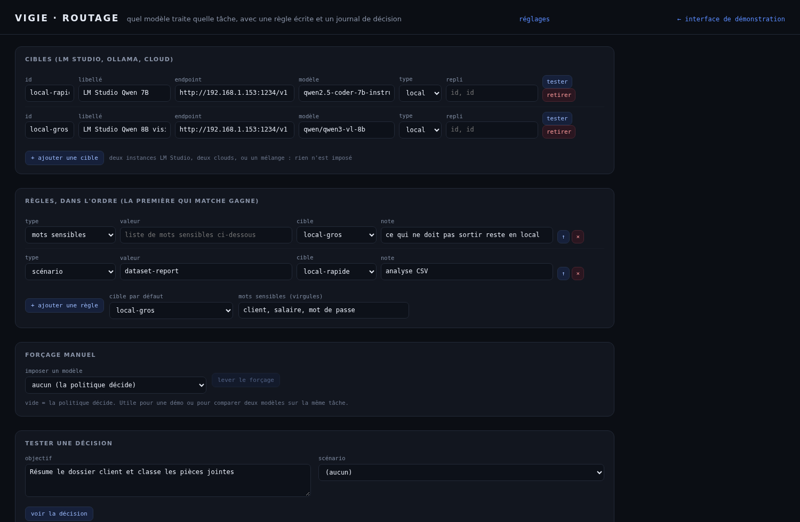

# Vigie

### L'agent qui prend le quart : il agit, il vérifie, il apprend de ses erreurs.

[](https://github.com/hollow313/ASUS-Agent-Computer-Challenge---High-End/actions/workflows/docker-build.yml)


**Français** · [English](README.en.md)

Candidature à l'ASUS Agent Computer Challenge, catégorie **High-End**.

---

## Le résultat, en une ligne

Un agent reçoit un objectif, choisit ses outils, agit, **relit ce qu'il a produit** et rend un
livrable sur le disque. Quand une étape casse, il écrit la leçon et l'applique au run suivant :
**6 étapes et 1 erreur deviennent 4 étapes et 0 erreur**.

Trois commandes, aucune clé, aucun réseau, aucune dépendance :

```bash
docker run --rm -p 8080:8080 holloow313/asus-agent-computer-challenge-high-end:latest
python3 -m agentdemo run --scenario self-repair     # la démo en terminal
python3 -m unittest discover -s tests               # 29 tests, 190 ms
```

Puis, dans l'interface : **Auto-réparation**, qui montre l'apprentissage en trois passes.

**Les chiffres, mesurés sur ma machine** (GPU 3 Go de VRAM, quantification Q4, 10 tâches
vérifiables, notation par correspondance exacte) :

| Cible | Modèle | Réussite | p50 | p95 | Coût / 1 000 tâches |
| --- | --- | --- | --- | --- | --- |
| Local | qwen2.5-coder-7b | 60 % | 0,48 s | 0,93 s | 0 € |
| Local | qwen3-vl-8b | 90 % | 18,9 s | 38,2 s | 0 € |
| Cloud | deepseek-flash | 100 % | 1,02 s | 1,61 s | 0,05 € |

Vitesse et justesse s'excluent sur ce matériel : le modèle rapide se trompe quatre fois sur dix,
le modèle juste coûte trente-neuf fois plus de temps. C'est la mesure du goulot, et l'objet de la
candidature. Méthode, limites et ce que ces chiffres ne disent pas :
[`docs/comparatif-local-cloud.md`](docs/comparatif-local-cloud.md).

**Deux vidéos, voix off produite par l'agent lui-même** :

- [`docs/video/agent-computer-demo.mp4`](docs/video/agent-computer-demo.mp4), 64 s : la boucle
  agentique, la mémoire procédurale, les mesures.
- [`docs/video/agent-computer-delegation.mp4`](docs/video/agent-computer-delegation.mp4), 41 s :
  l'orchestration de sous-agents, budget cloisonné et agrégation.


---

## Le problème

Un agent IA ne sert à rien s'il faut lui réexpliquer le contexte à chaque fois et exécuter soi-même
ce qu'il propose. Ce que je voulais, c'est une machine qui reçoit un objectif en langage naturel,
choisit ses outils, agit, vérifie son résultat et garde la mémoire de la procédure, y compris quand
je dors.

Le frein n'est pas le modèle, c'est le calcul. Avec 3 Go de VRAM, tout ce qui demande du
raisonnement part sur le cloud : coût par token, dépendance réseau, et surtout impossibilité de
traiter en local les documents clients et personnels.

Cette démo répond à la première moitié du problème : montrer, avec du code qu'on peut lancer, que
la boucle agentique tient debout et qu'elle s'améliore avec l'usage. La seconde moitié est une
question de mémoire vidéo, traitée plus bas.

---

## Ce que fait l'agent

```
objectif → planification → appel d'outil → observation → vérification → livrable
                                ↑                              │
                                └──────── journal du run ──────┘
```

Trois choses sont réelles ici, et c'est ce qui distingue un agent d'un chatbot :

1. **Les décisions sont séquencées par le système, pas par l'utilisateur.** L'agent enchaîne seul
   les étapes sous un budget maximal : au-delà, le run s'arrête proprement (statut `budget`) au
   lieu de boucler.
2. **Les outils ont des effets réels.** Les fichiers écrits existent, les messages déplacés le sont
   vraiment, le graphique SVG est calculé à partir des données. Rien n'est une capture d'écran.
3. **La vérification fait partie de la boucle.** Dans chaque scénario, l'agent relit le fichier
   qu'il vient d'écrire avant de conclure. Un livrable annoncé n'est pas un livrable.

Cinq scénarios sont fournis, tous exécutables sans modèle :

| Scénario | Objectif donné à l'agent | Livrables réels |
| --- | --- | --- |
| `cyber-brief` | Agréger trois flux, hiérarchiser, rédiger un briefing daté | `briefing.md` |
| `inbox-triage` | Lire 5 messages, classer en déplaçant les fichiers, rapport d'actions | `rapport-tri.md` + `triaged/` |
| `dataset-report` | Profiler un CSV, tracer un graphique, produire une note à 3 constats | `synthese.md`, `graphique.svg` |
| `delegation` | Déléguer trois zones à trois sous-agents, relire leurs livrables, agréger | `comparatif.md` + 3 `resume.md` |
| `self-repair` | **Trois passes sur le même objectif** : la première se casse et écrit une procédure, la deuxième l'applique, la troisième la voit devenir fausse et la remplace | `veille.md` + deux versions de la procédure |

### L'auto-amélioration, sans mythologie

L'agent ne s'entraîne pas, il **capitalise des procédures**. Quand une étape échoue, il écrit la
leçon en markdown (`skill_write`) ; au run suivant, il la relit avant d'agir (`skill_recall`).

Le problème d'une procédure, c'est qu'elle peut devenir **fausse** : un fichier renommé, une API
qui change, un sélecteur qui ne matche plus. Alors chaque procédure porte un cycle de vie, et c'est
ce que la troisième passe du scénario `self-repair` démontre :

- **un contrat de vérification** : la procédure déclare ce dont elle dépend
  (`check: path_exists feeds/flux-avis-112026.xml`), rejoué à chaque rappel ;
- **détection automatique** : le fichier est renommé entre deux passes, le contrat casse, la
  procédure est marquée `stale` et **n'est plus servie** : l'agent réexplore au lieu d'appliquer une
  leçon morte ;
- **score de confiance** : (succès + 1) / (usages + 2), lissage de Laplace. Une procédure neuve part
  à 50 %, pas à 100 %, et chaque retour d'expérience (`skill_feedback`) la fait monter ou descendre ;
- **mise à la retraite réversible** : `skill_prune` déplace les procédures périmées ou peu fiables
  dans `skills/retired/`, jamais de suppression. Elles restent consultables dans le registre.

Tout est visible, y compris en ligne de commande :

```bash
python3 -m agentdemo skills            # registre : statut, succès, usages, confiance, contrat
python3 -m agentdemo skills --prune    # met à la retraite ce qui est périmé
```

### Réécrire une procédure, arbitrer un conflit

Deux cas restaient ouverts, ils sont traités :

- **révision** : `skill_revise(name, content, check)` réécrit une procédure périmée, archive
  l'ancienne version dans `skills/history/`, puis ne la réactive **que si le nouveau contrat
  passe**. Un modèle peut proposer la réécriture en mode réel, la vérification reste mécanique.
  Une révision non vérifiée laisse la procédure `stale` : on ne remplace pas une leçon morte par
  une leçon non contrôlée ;
- **arbitrage** : deux procédures du même sujet (`topic`) ne cohabitent pas. `skill_resolve`
  garde celle qui a la meilleure confiance, puis le plus d'usages, puis la plus récente. La perdante
  passe `superseded` et pointe vers la gagnante, sans être supprimée.

### L'entretien tourne tout seul

Le déclenchement automatique existe, sous forme de tâche de fond :

```bash
python3 -m agentdemo maintain --once            # une passe, pour voir
python3 -m agentdemo maintain --interval 300    # toutes les cinq minutes, jusqu'à Ctrl+C
```

À chaque passe, le mainteneur fait trois choses sans qu'on lui demande :

1. **réparer** : une procédure dont la cible a été renommée est retrouvée par ressemblance de nom,
   son contrat est réécrit, et elle n'est réactivée que si le nouveau contrat passe. Vérifié : un
   fichier renommé de 2027 en 2028 est détecté et la procédure repart seule ;
2. **arbitrer par la preuve** : entre deux procédures du même sujet, celle dont le contrat se
   vérifie gagne, même si l'autre a une meilleure confiance. Le score ne remplace pas un fait ;
3. **retirer** ce qui reste faux ou dormant, en le déplaçant dans `skills/retired/`.

Chaque passe écrit une ligne dans `maintenance.jsonl`, et l'interface expose le même déclenchement
sur `POST /api/maintenance/run`. Côté agent, l'outil `maintenance_run` permet de le faire pendant
un run.

Ce qui reste hors périmètre, et je l'assume : l'évaluation du **contenu** de deux procédures
contradictoires (le sujet et le contrat sont arbitrés, pas la formulation), et la réécriture d'une
procédure dont la cible a **disparu sans successeur crédible**, qui finit simplement en retraite.


### Orchestration : un agent peut en convoquer d'autres

Un agent seul devient vite un agent qui fait tout mal. Le scénario `delegation` montre l'autre
approche : le parent ne traite pas les trois zones lui-même, il **délègue** chacune à un sous-agent
(`spawn_agent`), avec son propre répertoire, sa propre trace et son propre budget d'étapes. Puis il
relit les livrables rendus avant d'agréger, au lieu de faire confiance à des résumés.

```
parent (6 étapes)
├── sous-agent nord (3 étapes) → delegations/nord/resume.md
├── sous-agent sud  (3 étapes) → delegations/sud/resume.md
├── sous-agent ouest (3 étapes) → delegations/ouest/resume.md
└── agrégation → comparatif.md
```

Ce qui compte : le budget est **cloisonné** (un sous-agent bavard ne peut pas épuiser le parent),
les artefacts sont **rangés** par délégation, et le parent **vérifie** ce qu'il reçoit. C'est le
même mécanisme que mon agent de production utilise pour paralléliser des tâches indépendantes.

---

## Orchestration de sous-agents

Un sous-agent n'est pas un appel de fonction : il a son propre budget, son propre journal, son
propre bac à sable dans `delegations/<nom>/`, et le parent ne partage rien avec lui. Le parent lui
transmet l'inventaire des fichiers, sinon le sous-agent cherche des chemins qui n'existent pas.

Deux modes : si une cassette existe pour ce nom, le sous-agent la rejoue, déterministe ; sinon il
hérite de l'endpoint et du modèle du parent et travaille pour de bon. Mesuré sur ce dépôt, mode
réel contre une API compatible OpenAI : trois zones, trois sous-agents, trois livrables, parent qui
les relit et écrit `comparatif.md`. La profondeur est bornée à trois niveaux, un sous-agent déjà
lancé ne se relance pas, et trois appels identiques en échec arrêtent le run au lieu de consommer
le budget en boucle.

## Quel modèle pour quelle tâche

Un agent qui parle à un seul modèle est un agent qui prend le mauvais outil pour chaque tâche. La
page **`/routing`** règle la politique : autant de cibles qu'on veut (deux instances LM Studio,
deux clouds, ou un mélange), des règles ordonnées, et un forçage manuel pour les démonstrations.

Les règles s'évaluent dans l'ordre, la première qui matche gagne : mots sensibles (donc local),
scénario, motif dans l'objectif, puis un garde-fou. Chaque exécution réelle journalise sa décision,
cible, modèle et raison.



```bash
python3 -m agentdemo route --objective "Résume le dossier client"     # → local, données sensibles
python3 -m agentdemo route --objective "Analyse ce jeu de données" --scenario dataset-report
python3 -m agentdemo route --override lm-32b                          # force une cible
```

Dans l'interface de démonstration, un bouton mène à cette page, et la barre de statut d'un run
affiche la cible retenue avec sa raison. Détail complet : [`docs/ROUTAGE.md`](docs/ROUTAGE.md). Exploitation et planning : [`docs/EXPLOITATION.md`](docs/EXPLOITATION.md).

---

## Des entrées réelles, et un planning

Une démonstration se juge aussi sur ce qu'elle sait brancher. La page **`/settings`** déclare les
vraies entrées : un dossier de CSV à traiter, des flux RSS, un compte IMAP avec son dossier
d'archive. Le mot de passe est stocké dans le volume en 0600 et n'est jamais renvoyé par l'API.


Les CSV configurés sont copiés dans `inputs/` au début de chaque run, et deux outils les
exploitent : `inputs_list` et `csv_dir_profile` (profil de chaque fichier et totaux par colonne).
Côté courrier, `mail_list` et `mail_move` parlent à la boîte IMAP pour de vrai, avec `imaplib` de
la bibliothèque standard. Sans compte configuré, l'outil refuse proprement et dit où le renseigner.

La même page planifie les scénarios : **chaque jour à heure fixe** ou **toutes les N minutes**,
en mode réel ou replay. Le planificateur tourne dans le processus du serveur, relit le fichier de
réglages à chaque tour et consomme chaque échéance une seule fois. Une tâche créée après son heure
se déclenche une fois, puis reprend son rythme : c'est le rattrapage voulu après une coupure.

```
08:00  veille cyber    → briefing daté          (chaque jour, heure fixe)
02:00  rapport CSV     → analyse + graphique    (toutes les 1440 minutes)
```

Une tâche planifiée en mode réel ne choisit pas son modèle : c'est la politique de `/routing` qui
décide, et la décision est journalisée dans le run comme pour un lancement manuel.

---

## Créer un scénario sans toucher au code

Le bouton **＋ nouveau scénario** de l'interface crée un scénario en trois champs : slug, objectif,
description. Un scénario neuf n'a pas de cassette, donc il se lance en mode réel une première fois,
puis le bouton **enregistrer cette trace comme cassette** transforme le run en trace rejouable.
Le contrat reste honnête : la cassette ne contient que les décisions, les observations sont
reproduites à l'exécution par les vrais outils.

---

## Pourquoi 32 Go, et ce que ça change

Le matériel visé par la candidature est une **ASUS TURBO Radeon AI PRO R9700 32 Go**. Ce n'est pas
une demande de confort, c'est le dimensionnement du problème, et mes propres mesures le montrent :
sur 3 Go de VRAM, un agent qui enchaîne huit étapes doit choisir entre être rapide et être juste.

| Aujourd'hui (3 Go) | Avec 32 Go |
| --- | --- |
| 7-8 B en Q4, 60 à 90 % de réussite | 32 B en Q5 entièrement en mémoire, 70 B en Q4 possible |
| contexte court, étapes sacrifiées | contexte long, historique complet du run |
| veille et courrier traités sur le cloud | tout reste sur la machine, données sensibles comprises |
| RAG personnel irréaliste | index sur mes archives, réponses citées |

### Ce que ça donne, chiffré

Le dimensionnement se calcule, il ne s'espère pas. `agentdemo fit` fait le calcul pour une carte et
un contexte donnés : poids selon la quantification, cache d'attention, marge pour le runtime.

```bash
python3 -m agentdemo fit --vram 32 --context 32768
```

```
modèle                     taille        quant   mémoire    marge
qwen2.5-coder-7b            7.6 B           Q8    11.7 Go   20.3 Go
qwen2.5-coder-14b          14.7 B           Q8    20.9 Go   11.1 Go
mistral-small-24b          23.6 B           Q6    26.9 Go    5.1 Go
qwen2.5-coder-32b          32.8 B           Q4    30.4 Go    1.6 Go
llama-3.3-70b              70.6 B ne rentre pas    56.0 Go  -24.0 Go
```

À 8 k de contexte, le même 32B monte en Q6. À 16 Go de VRAM, il ne rentre pas du tout, même en Q4 :
c'est précisément pour ça que la carte visée est en 32 Go, et pas une carte intermédiaire.

L'argument n'est pas le prix du token : à 5 centimes les 1 000 exécutions, le cloud le moins cher
reste moins cher qu'une carte pour mon volume actuel, et je l'assume dans le comparatif. Les trois
vrais arguments sont la **souveraineté** (ce qui ne doit pas sortir ne sort plus), la **parité de
qualité en local** (un 32B en Q5, c'est le palier où le local cesse d'être un compromis) et la
**disponibilité** (un agent qui tourne 24/7 ne dépend ni d'un quota ni d'un changement de tarif).

### Et après, si j'ai cette carte

Ce dépôt n'est pas une fin en soi, c'est la première brique d'une suite que je peux exécuter seul,
et que je décris ici parce que c'est aussi ce que le matériel rend possible :

1. **Un RAG personnel** sur mes archives (notes, procédures, exports, documentation client), avec
   réponses citées et index reconstruit à chaque ajout. Tenir un index utile avec un 8B sur 3 Go de
   VRAM n'est pas réaliste aujourd'hui.
2. **Un affinage supervisé** d'un petit modèle sur mes propres traces d'exécution, avec les outils
   standards de la communauté (Unsloth, Axolotl, PEFT/LoRA). 32 Go permettent de faire du QLoRA sur
   des modèles 7 à 14B en local, sans louer de GPU à l'heure.
3. **Un routeur de modèles** qui choisit local ou cloud selon la tâche, la sensibilité des données
   et le coût, avec un journal de décision. La brique existe déjà dans la démo (deux
   planificateurs, une seule boucle), il reste à la piloter par des règles mesurées.
4. **Un second utilisateur**, en ouvrant l'agent au foyer via une interface web, avec des
   procédures séparées et un quota de calcul.

Chaque étape produit une mesure publiable. C'est ma façon de travailler : une brique, un chiffre,
un livrable.

---

## Trois projets, un seul dépôt concouru

Le règlement autorise un seul niveau de candidature par participant. J'en avais préparé trois,
voici les deux autres, si le jury veut voir la suite :

| Niveau | Projet | Ce qu'il fait |
| --- | --- | --- |
| AI Entry | [Archiviste](https://github.com/hollow313/ASUS-Agent-Computer-Challenge---AI-Entry) | Lit un classeur administratif local, relève les échéances, répond avec sources, et refuse ce qui sort du périmètre |
| Developer | [RGAA Agent](https://github.com/hollow313/ASUS-Agent-Computer-Challenge---Developer) | Audite un site, corrige réellement le HTML, re-audite : 63,9 % à 100 % de conformité sur le site de démonstration |

Celui-ci, **Vigie**, est le plus avancé des trois : un agent déjà en production, avec sa démo
exécutable et ses mesures.

---

## Pour celui qui veut le monter

### Docker (recommandé)

```bash
docker run --rm -p 8080:8080 holloow313/asus-agent-computer-challenge-high-end:latest
# sans image publiée : docker build -t vigie . && docker run --rm -p 8080:8080 vigie
```

### Sans Docker, Python 3.10 minimum

```bash
python3 -m agentdemo serve --port 8080
# en terminal uniquement :
python3 -m agentdemo run --scenario cyber-brief
python3 -m agentdemo run --scenario self-repair
```

Aucune dépendance à installer : le paquet n'utilise que la bibliothèque standard (voir
`requirements.txt`, volontairement vide).

### Volumes, UID et montages (NAS, TrueNAS)

Le conteneur tourne en **UID/GID 568**, l'identifiant des applications sur TrueNAS SCALE, donc les
fichiers écrits restent lisibles depuis l'hôte. Si vous forcez un autre utilisateur, passez
`-u $(id -u):$(id -g)` : la seule contrainte est que `/data` soit inscriptible par cet UID.

**Un seul dossier est à monter : `/data`.** Il contient les runs, les livrables, les journaux JSON
et les procédures apprises. Rien d'autre : aucun fichier de configuration, aucun secret, aucun
accès au socket Docker.

```bash
# volume nommé, rien à préparer
docker run --rm -p 8080:8080 -v agentdemo-data:/data \
  holloow313/asus-agent-computer-challenge-high-end:latest

# dossier de l'hôte, à donner au UID 568 avant de démarrer
mkdir -p /mnt/tank/apps/agent-demo && chown -R 568:568 /mnt/tank/apps/agent-demo
docker run --rm -p 8080:8080 -v /mnt/tank/apps/agent-demo:/data \
  holloow313/asus-agent-computer-challenge-high-end:latest
```

### Brancher un vrai modèle, local ou cloud

Le mode de démonstration ne fait aucun appel réseau. Le mode réel pointe vers tout endpoint
compatible OpenAI : LM Studio, Ollama, vLLM, ou une API distante.

Dans l'interface, bouton **live (modèle)** : trois champs apparaissent (endpoint, modèle, clé
optionnelle), avec un bouton **vérifier l'endpoint** qui interroge `/models`, liste les modèles
chargés et remplit le champ. Quatre préréglages sont fournis : LM Studio, Ollama, DeepSeek, Gemini.


En ligne de commande, mêmes valeurs en options :

```bash
python3 -m agentdemo run --scenario cyber-brief --live \
  --base-url http://MON-IP:1234/v1 \
  --model llama-3.1-8b
```

En variables d'environnement, pratique dans un conteneur : `AGENTDEMO_LLM_BASE_URL`,
`AGENTDEMO_LLM_MODEL`, `AGENTDEMO_LLM_API_KEY`. Le suffixe `/v1` est ajouté automatiquement s'il
manque, et l'interface explique l'erreur au lieu de renvoyer un code brut.

---

## Sous le capot

### Deux planificateurs, une seule boucle

Le cœur (`agentdemo/agent.py`) ne sait pas d'où viennent les décisions. Deux backends implémentent
la même interface :

- **`ReplayPlanner`**, par défaut : rejoue une trace de décisions enregistrée
  (`scenarios/<slug>/cassette.json`). Déterministe, hors ligne, sans clé. **Les outils, eux,
  s'exécutent réellement** : le bac à sable est vrai, les fichiers sont vrais. C'est ce qu'un
  reviewer peut lancer en 30 secondes sans rien installer d'autre.
- **`OpenAICompatPlanner`** : parle à tout endpoint `/chat/completions` compatible OpenAI. Le
  modèle reçoit le catalogue d'outils dans son prompt système et répond par une action JSON unique.

### Les outils

Dix-huit outils, tous dans le bac à sable du run. Fichiers : `fs_list`, `fs_read`, `fs_write`,
`fs_move`. Analyse : `csv_profile`, `chart_bar`, `rss_rank`. Réseau : `http_get`, désactivé par
défaut. Voix : `tts_speak`, via un endpoint `/audio/speech`, désactivé par défaut. Orchestration :
`spawn_agent`. Mémoire : `skill_list`, `skill_recall`, `skill_write` (contrat de vérification),
`skill_revise`, `skill_resolve`, `skill_feedback`, `skill_prune`, `maintenance_run`. Un chemin
absolu ou une remontée `../` est refusé, pas corrigé.

### Modèle de sécurité

- **Bac à sable par run** : les chemins hors périmètre sont rejetés par `Sandbox.resolve()`.
- **Réseau coupé par défaut** : `AGENTDEMO_ALLOW_NETWORK=0`, et les outils réseau échouent avec un
  message explicite au lieu de simuler un succès.
- **Aucune suppression** : le tri se fait par déplacement, tout reste réversible.
- **Budget d'étapes** : dépassement = statut `budget`, jamais de boucle infinie.
- **Journal complet** : chaque run est rejouable et vérifiable sur disque.
- **Conteneur non privilégié** : UID 568, pas de mode privilégié, pas de socket Docker.

Aucun secret, aucun identifiant, aucune donnée personnelle dans ce dépôt. Les données des scénarios
sont synthétiques et vivent dans `agentdemo/scenarios/*/fixtures`.

### Structure du dépôt

```
agentdemo/
├── agent.py              # la boucle : planification, outil, observation, bilan
├── planners.py           # ReplayPlanner (hors ligne) + OpenAICompatPlanner (modèle réel)
├── tools.py              # 18 outils : fichiers, analyse, voix, procédures, délégation
├── skills.py             # mémoire procédurale : contrats, confiance, révision, arbitrage
├── maintenance.py        # entretien automatique : réparer, arbitrer, retirer
├── fit.py                # dimensionnement mémoire : ce qui tient dans une carte
├── routing.py            # politique de routage : cibles, règles, forçage, historique
├── settings_store.py     # entrées réelles et tâches planifiées (mot de passe jamais renvoyé)
├── mailbox.py            # lecture et tri d'une vraie boîte IMAP (imaplib)
├── doctor.py             # diagnostic d'installation
├── export.py             # archive d'un run : journal, livrables, synthèse
├── scenarios_loader.py   # chargement des scénarios, cassettes et fixtures
├── cli.py                # CLI : run, serve, doctor, export, fit, skills, maintain, validate, new
├── server.py             # API HTTP et interface web (http.server, stdlib)
├── web/index.html        # interface d'une page, aucune dépendance
├── web/routing.html      # page de configuration du routage
├── web/settings.html     # page d'exploitation : entrées, IMAP, planning
└── scenarios/            # cyber-brief, inbox-triage, dataset-report, delegation, self-repair
tests/test_demo.py        # 29 tests : scénarios, procédures, délégation, bac à sable
bench/                    # banc de mesure : tâches, prix, endpoint simulé
video/                    # cartons, capture d'interface et script de narration
docs/                     # captures, architecture, comparatif, scénarios, parcours 3 min
```

### API

| Route | Méthode | Rôle |
| --- | --- | --- |
| `/` | GET | interface web |
| `/api/scenarios` | GET | liste des scénarios |
| `/api/run` | POST | `{"scenario": "...", "mode": "replay\|live", "llm": {...}}` |
| `/api/runs/<id>` | GET | état, étapes, bilan, livrables |
| `/api/artifacts/<id>/<chemin>` | GET | téléchargement d'un livrable |
| `/api/skills` | GET | procédures apprises, confiance et statut |
| `/api/maintenance` | GET | dernières passes d'entretien |
| `/api/maintenance/run` | POST | déclenche une passe d'entretien |
| `/api/runs/<id>/export` | GET | archive du run : journal et livrables |
| `/api/routing` | GET, POST | politique de routage : cibles, règles, forçage |
| `/api/routing/decide` | POST | décision pour un objectif, avec la version sans forçage |
| `/routing` | GET | page de configuration du routage |
| `/settings` | GET | page d'exploitation : entrées, IMAP, planning |
| `/api/settings` | GET, POST | entrées réelles et tâches planifiées |
| `/api/settings/test-mail` | POST | teste la connexion IMAP |
| `/api/jobs/<id>/run` | POST | lance une tâche planifiée maintenant |
| `/api/scenarios` | POST | crée un scénario utilisateur |
| `/api/scenarios/<slug>/record` | POST | enregistre la trace d'un run comme cassette |
| `/api/llm/models` | GET | sonde un endpoint compatible OpenAI |
| `/healthz` | GET | sonde de santé |

---

## Vérifier par soi-même

```bash
python3 -m unittest discover -s tests -v   # 29 tests, aucun framework
python3 -m agentdemo validate              # cohérence des cassettes avec les outils
python3 -m agentdemo skills                # registre des procédures et leur confiance
python3 -m agentdemo maintain --once       # entretien : réparer, arbitrer, retirer
python3 -m agentdemo fit --vram 32         # ce qui tient dans la carte visée
python3 -m agentdemo route --objective "…"  # décision de routage pour un objectif
python3 -m agentdemo doctor                # diagnostic d'installation, avant de lancer
python3 -m agentdemo export                # archive le dernier run : journal et livrables
python3 bench/bench.py --targets bench/targets.json
```

La CI fait quatre choses à chaque push : tests sur Python 3.10 et 3.12, les cinq scénarios en
ligne de commande, publication de l'image (Docker Hub et GHCR) et un test qui **démarre le
conteneur**, appelle `/healthz`, lance un scénario et télécharge le livrable produit.

### Vérifier l'installation, emporter une preuve

Avant de lancer quoi que ce soit, `doctor` fait les contrôles à la place du juré : version de
Python, dossier de données inscriptible, scénarios et cassettes chargeables, mémoire procédurale
accessible, espace disque, présence de Docker, et endpoint de modèle si on lui en donne un. Sortie
lisible, code de retour non nul si un contrôle bloquant échoue.

```bash
python3 -m agentdemo doctor --base-url http://MON-IP:1234/v1
```

```
[ok]   Python 3.10 ou plus : 3.14.9 détecté
[ok]   Scénarios chargeables : cyber-brief, dataset-report, delegation, inbox-triage, self-repair
[ok]   Cassettes présentes : toutes
[ok]   Mémoire procédurale accessible : 0 procédure(s)
[info] Endpoint de modèle : non testé (optionnel)

Installation prête.
```

Et `export` produit une archive lisible d'un run, pour que le jury garde une trace au lieu de
faire confiance à une capture d'écran : le journal complet, les livrables réellement écrits et une
page de synthèse. Les fixtures d'entrée ne sont pas incluses, seuls les livrables déclarés le sont.

```bash
python3 -m agentdemo export --run 7bc8dc6633 --file audit.zip
# ↔ journal/7bc8dc6633-p1.json, livrables/synthese.md, livrables/graphique.svg, LISEZ-MOI.txt
```

Le même téléchargement est disponible depuis l'interface et l'API : `GET /api/runs/<id>/export`.

Le banc de mesure répond à la seule question qui compte pour un Agent Computer : combien ça coûte
et qu'est-ce que ça donne de faire tourner l'agent en local. Trois chiffres par cible : réussite sur
10 tâches réelles notées par correspondance exacte, latence p50 et p95, coût pour 1 000 exécutions.
Détail dans [`bench/README.md`](bench/README.md).

---

## Ce que cette démo n'est pas

Un jury technique le verra de toute façon, autant l'écrire :

- **Ce n'est pas mon agent de production.** L'instance réelle tourne en permanence sur un serveur
  personnel, avec une centaine de procédures écrites par l'agent, vingt tâches planifiées, un
  navigateur piloté sur une autre machine, la gestion du courrier et un routage local/cloud. Elle
  contient des données privées, donc elle ne se publie pas.
- **Le mode replay ne raisonne pas.** Il rejoue des décisions enregistrées. C'est un choix : une
  démo qui exige une clé ou un modèle de 20 Go n'est pas une démo, c'est une condition d'accès. Le
  mode réel existe pour prouver que la boucle fonctionne avec un vrai modèle.
- **Le catalogue d'outils est réduit** à dix-huit outils, tous en fichiers et en analyse. Pas de
  shell, pas d'envoi de courrier, pas d'automatisation de navigateur ici.
- **La mémoire procédurale est réduite, mais son cycle de vie est réel** : contrats de
  vérification, score de confiance, révision, arbitrage et entretien périodique existent et sont
  testés. Ce qui manque par rapport à la production : l'évaluation du contenu de deux procédures
  contradictoires, et un historique long permettant de mesurer la dérive dans le temps.

Ce qui est démontré n'est pas simulé : la boucle, les outils, le bac à sable, le journal, la
vérification, l'arrêt propre en cas d'erreur ou de budget dépassé.

---

## Ajouter un scénario

```bash
python3 -m agentdemo new --slug tri-factures --title "Tri de factures" \
  --objective "Classe les factures du dossier inbox et écris rapport.md."
python3 -m agentdemo validate --slug tri-factures
python3 -m agentdemo run --scenario tri-factures
```

Un scénario, c'est un dossier avec `scenario.json` (objectif, budget d'étapes), `cassette.json`
(une action par étape, clés d'`args` strictement conformes à la signature de l'outil) et
`fixtures/` (données synthétiques). La commande `validate` compare les cassettes aux outils réels :
outil inconnu, argument manquant ou superflu, absence de conclusion. Format complet et pièges :
[`docs/SCENARIOS.md`](docs/SCENARIOS.md).

Un parcours de trois minutes pour un évaluateur pressé est dans [`docs/DEMO.md`](docs/DEMO.md).

---

## Licence et auteur

MIT, voir `LICENSE`. Auteur : Loïc Huon.

---

## English summary

**Vigie** (French for the lookout on watch): an agent that takes an objective, picks tools, acts,
re-reads what it produced and leaves a verifiable deliverable. When a step breaks, it writes the
lesson and applies it next run, so 6 steps and 1 error become 4 steps and 0 errors.

Zero dependency, no key, no network: `docker run -p 8080:8080
holloow313/asus-agent-computer-challenge-high-end:latest`, or `python3 -m agentdemo serve`.
Five scenarios (including delegation to sub-agents), 17 tests, a measurement bench, and a CI that
runs the container and downloads a deliverable. Measured on a 3 GB VRAM GPU: local 7B at 60 % and 0.48 s, local 8B at 90 % and
18.9 s, cloud at 100 % and 1.02 s for 0.05 € per 1 000 tasks.

Full English documentation: [README.en.md](README.en.md).
