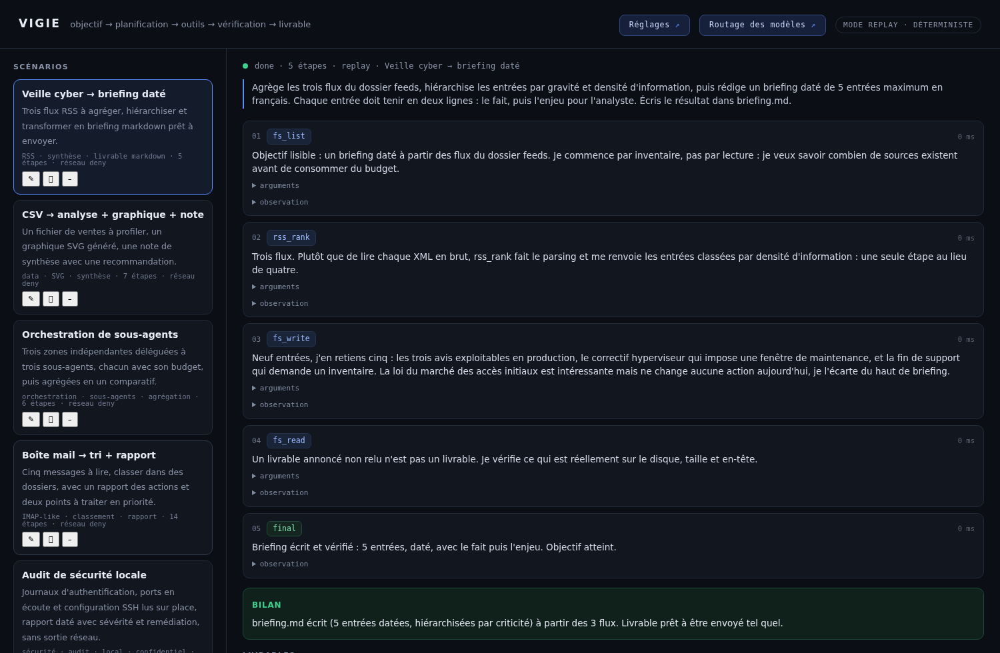
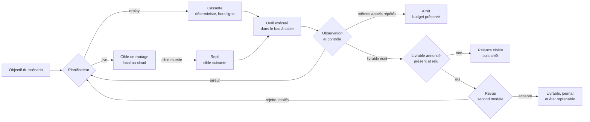

[**Français**](README.md) · [English](README.en.md)

# Vigie

**Un agent qui prend le quart 24 heures sur 24.** Il reçoit un objectif, choisit ses outils, écrit
des fichiers, relit ce qu'il a produit, apprend de ses erreurs et reprend son travail après un crash.

[La présentation en vidéo](https://youtu.be/YmQbnhEh1Ps) · [Démo en 30 secondes](#en-trente-secondes) · [Les chiffres](#les-chiffres-mesurés) · [Les limites](#limites-assumées)


**Candidature ASUS Agent Computer Challenge, catégorie High-End.** Vigie est la version distribuable de l'agent qui tourne sur ma machine depuis des mois ; ce dépôt en publie le cœur, sans mes données ni mes clés.

## Sommaire

- [En trente secondes](#en-trente-secondes)
- [Ce que fait l'agent](#ce-que-fait-lagent)
- [Ce que la carte débloque](#ce-que-la-carte-débloque)
- [Les chiffres mesurés](#les-chiffres-mesurés)
- [Huit scénarios, huit livrables](#huit-scénarios-huit-livrables)
- [Un cas réel, sur internet](#un-cas-réel-sur-internet)
- [Architecture et boucle](#architecture-et-boucle)
- [Robustesse : repli, reprise, revue](#robustesse-repli-reprise-revue-autorisations)
- [Sécurité et données](#sécurité-et-données)
- [Limites assumées](#limites-assumées)
- [Construire, tester, étendre](#construire-tester-étendre)

## En trente secondes

```bash
git clone https://github.com/hollow313/ASUS-Agent-Computer-Challenge---High-End
cd ASUS-Agent-Computer-Challenge---High-End
python3 -m agentdemo scenarios                  # les huit scénarios
python3 -m agentdemo run --scenario cyber-brief # un run complet, déterministe
python3 -m agentdemo serve --port 8080          # la même chose avec l'interface
python3 -m unittest discover -s tests           # 72 tests, trois secondes
```

### ▶ La présentation en vidéo

[](https://youtu.be/YmQbnhEh1Ps)

*Cliquez sur l'image pour lancer la vidéo sur YouTube (2 min 25).*

Elle montre les sept premiers scénarios, la mémoire procédurale, la délégation, le routage
avec repli, la reprise après crash, la revue par un second modèle, l'accord manuel et le dimensionnement
de la carte. La démo courte, 1 min 03, est aussi en ligne : [youtu.be/rUKwZeVePNs](https://youtu.be/rUKwZeVePNs).
Le fichier reste dans le dépôt : [`docs/video/vigie-presentation.mp4`](docs/video/vigie-presentation.mp4).

Aucune dépendance, aucune clé, aucun accès réseau : le mode replay rejoue des décisions enregistrées,
mais les outils s'exécutent pour de vrai. Les fichiers sont écrits, le CSV est calculé, le graphique
est généré.

```bash
docker run --rm -p 8080:8080 holloow313/asus-agent-computer-challenge-high-end:latest
```

Pour le mode réel, l'agent ne contient aucun modèle : il parle l'API compatible OpenAI, donc Ollama,
LM Studio, vLLM ou une API distante se valent. Rien n'est à installer dans l'image.



```bash
ollama pull qwen2.5-coder:7b
python3 -m agentdemo run --scenario cyber-brief --live \
  --base-url http://localhost:11434/v1 --model qwen2.5-coder:7b
```

Avec Docker et rien d'installé, `docker compose --profile ollama up -d` puis
`docker compose exec ollama ollama pull qwen2.5-coder:7b`. Le bouton **tester** de la page de routage
interroge `/models` et dit tout de suite si le chemin est bon.

## Ce que fait l'agent

Trois phrases, sans vocabulaire de brochure. Un assistant conversationnel répond ; cet agent **agit** :
il choisit un outil dans un catalogue, l'exécute dans un bac à sable, observe le résultat, puis décide
de la suite. Il ne s'arrête pas sur une promesse, il s'arrête sur un fichier écrit et relu. Et quand
une étape casse, il enregistre la leçon dans une procédure qu'il relira au prochain run.

Ce qu'il exige : Python 3.10, rien d'autre. Pas de compte, pas de réseau, pas de GPU pour la
démonstration. Ce qu'il produit : des livrables datés, un journal d'étapes horodaté et un journal
d'événements, vérifiables ligne par ligne.

## Ce que la carte débloque

La machine actuelle a 3 Go de VRAM. Le plus gros modèle qui rentre fait 7 milliards de paramètres en
4 bits : rapide, gratuit, et faux une fois sur deux. Le modèle qui comprend les tâches ambiguës ne
rentre pas, les sous-agents ne tournent pas en parallèle, et le contexte reste trop court pour lire un
dossier entier.

32 Go de VRAM, ce n'est pas du confort : c'est la taille qui fait tenir un 32B en 4 bits, ou un 14B en
8 bits avec de la marge. Calculé par le dépôt, pas souhaité :

```
$ python3 -m agentdemo fit --vram 32 --context 32768

modèle                     taille        quant   mémoire    marge
qwen2.5-coder-7b            7.6 B           Q8    11.7 Go   20.3 Go
qwen2.5-coder-14b          14.7 B           Q8    20.9 Go   11.1 Go
qwen2.5-coder-32b          23.6 B           Q6    26.9 Go    5.1 Go
qwen2.5-coder-32b          32.8 B           Q4    30.4 Go    1.6 Go
llama-3.3-70b              70.6 B           Q4    56.0 Go   ne rentre pas
```

Un 32B en Q4 laisse 1,6 Go pour le contexte et les sous-agents : c'est juste, et c'est le bon
compromis. Un 70B ne rentre pas, même en Q4, et le dépôt le dit au lieu de le suggérer.

## Les chiffres mesurés

Mêmes 10 tâches, même prompt, température 0, notation déterministe par correspondance exacte. Ce n'est
pas une appréciation, c'est un test qui passe ou qui ne passe pas. Matériel : la carte 3 Go de VRAM qui
tourne aujourd'hui.

| Cible | Où | Réussite | p50 | p95 | Coût / 1 000 tâches |
| --- | --- | --- | --- | --- | --- |
| Qwen 2.5 Coder 7B, Q4 | local, 3 Go de VRAM | 60 % | 0,75 s | 3,98 s | 0 € |
| Qwen3 VL 8B, Q4 | local, 3 Go de VRAM | 90 % | 0,67 s | 4,63 s | 0 € |
| Gemini 3.8 Flash | cloud | 100 % | 4,17 s | 5,23 s | 0,07 € |

Les mêmes 1 000 tâches, aux prix publics du 21/11/2026 et avec la consommation de tokens réellement
mesurée (791 tokens d'entrée et 50 de sortie pour 10 tâches) :

| Modèle | Entrée / M tokens | Sortie / M tokens | 1 000 tâches |
| --- | --- | --- | --- |
| local, 8B Q4 | 0 € | 0 € | 0 € |
| Gemini 3.8 Flash | 0,69 € | 3,45 € | 0,07 € |
| Claude Opus 5.5 | 3,68 € | 18,40 € | 0,38 € |
| GPT-5.5 Pro | 27,60 € | 165,60 € | 3,01 € |

Trois lignes, une conclusion : le local est gratuit mais se trompe une fois sur deux ou prend six fois
plus de temps sur les cas lents, le cloud est juste mais sort vos données, et le modèle intermédiaire
qui ferait les deux n'existe pas dans 3 Go.

Le coût dépend du modèle, et il faut le dire précisément. À l'entrée de gamme, Gemini 3.8 Flash à
7 centimes les mille tâches, le cloud est moins cher que l'électricité de la carte : le prix n'est pas
l'argument. Sur un modèle de tête, GPT-5.5 Pro à 3,01 euros les mille tâches, soit quarante-trois fois
plus, la facture devient réelle : 12 euros par mois à 4 000 exécutions, contre 0,28 euro avec Gemini.
Elle reste loin du prix d'une carte de 32 Go, donc la conclusion tient, mais elle n'est plus « gratuit ».

Ce qui se vend ici n'est donc pas le prix : c'est la souveraineté, les données ne sortent pas ;
la disponibilité, pas de quota ni de coupure ; et une latence qui ne dépend pas d'un voisin.

Mesure du 21/11/2026 13:37 UTC, dix tâches, une passe. Rapport brut et JSON :
[`docs/mesures/mesures-20261121.md`](docs/mesures/mesures-20261121.md). Méthode, prix et fichiers :
[`bench/README.md`](bench/README.md) et
[`docs/comparatif-local-cloud.md`](docs/comparatif-local-cloud.md).

## Huit scénarios, huit livrables

Chaque scénario est un dossier : le contrat (`scenario.json`), une cassette de décisions, des
fixtures. Le même code rejoue ou exécute.

| Scénario | Ce qu'il fait | Livrable |
| --- | --- | --- |
| `cyber-brief` | agrège trois flux, hiérarchise, rédige | `briefing.md` daté |
| `dataset-report` | profile un CSV, calcule, dessine | `synthese.md` et `graphique.svg` |
| `inbox-triage` | lit une boîte IMAP, classe, rapporte | `rapport-tri.md` |
| `local-audit` | inspecte journaux, ports, permissions | `RAPPORT-AUDIT.md` |
| `delegation` | trois sous-agents, trois zones, agrégation | `comparatif.md` |
| `self-repair` | répare puis documente la veille | `veille.md` |
| `capture-audit` | une capture d'écran lue par le modèle local, mesurée par un outil, chaque constat cite une zone en pixels |
| `revue-contradictoire` | premier jet rejeté par un relecteur, puis corrigé | `synthese.md` |

Détail, cassettes et critères : [`docs/SCENARIOS.md`](docs/SCENARIOS.md).

### Un cas réel, sur internet

Le scénario livré `cyber-brief` lit des flux locaux, pour que la démonstration marche sans réseau.
Rien n'empêche l'agent d'aller sur internet quand le scénario y est autorisé : trois domaines en
allowlist, un run sur le 8B local, trois flux réels lus, `briefing.md` écrit avec les titres du jour et
les sources.

En mode `deny`, le même objectif donne `accès réseau refusé : scénario en mode deny`, et l'agent le dit
au lieu d'inventer un contenu. L'allowlist est vérifiée à chaque appel d'outil, hôte par hôte.

```bash
python3 -m agentdemo run --scenario cyber-brief --live \
  --base-url http://IP-DE-LA-MACHINE:1234/v1 --model qwen3-vl-8b
```

Les runs réels versionnés sont dans [`docs/runs/`](docs/runs), avec leur journal complet et leurs
échecs. Détail : [`docs/PRODUCTION.md`](docs/PRODUCTION.md).

## Architecture et boucle



Deux planificateurs derrière la même interface : `ReplayPlanner` rejoue une trace enregistrée, sans
réseau, et `OpenAICompatPlanner` interroge un endpoint compatible OpenAI. Le contrôle, le bac à sable et
le journal sont les mêmes dans les deux cas : ce qui change est la source des décisions, pas la machine.
Un run interrompu reprend depuis `state.json`, et la revue peut refuser deux fois avant l'arrêt.

Détail : [`docs/ARCHITECTURE.md`](docs/ARCHITECTURE.md).

## Robustesse : repli, reprise, revue, autorisations

Quatre mécanismes qui distinguent un agent d'une démonstration.

**Repli entre backends.** Une cible de routage peut déclarer des cibles de secours. Si la première ne
répond pas, l'agent bascule une fois, journalise `from`, `to` et la raison, et continue. Un modèle qui
répond mal n'est pas une panne : seule une erreur de transport déclenche la bascule.

**Reprise après crash.** Après chaque étape, l'agent écrit `state.json` en écriture atomique. Un
processus tué au milieu d'un run reprend à l'étape suivante, avec son historique, ses compteurs et ses
artefacts. `--resume`, `POST /api/runs/<id>/resume` et un bouton dans l'interface.

**Revue par un second modèle.** Avant de conclure, un relecteur lit les livrables déclarés et rend un
verdict motivé. Un rejet renvoie les motifs au rédacteur, qui corrige. Deux relectures au maximum, puis
arrêt : on ne brûle pas le budget à convaincre un relecteur.

**Autorisations visibles, scénario par scénario.** Décoché par défaut, parce qu'une tâche planifiée
tourne quand personne ne peut répondre. Une case dans l'éditeur de scénario demande votre accord avant
chaque écriture ou commande : la demande apparaît dans la page du run avec l'outil et ses arguments, et
sans réponse en deux minutes c'est refusé. Une tâche planifiée qui exige cet accord le note dans son
journal et poursuit, au lieu d'attendre deux minutes pour rien. Les valeurs sensibles configurées sont
masquées dans les pensées, les observations et le bilan.

## Sécurité et données

Le dépôt ne contient ni clé, ni adresse, ni donnée personnelle : un audit par clone et `grep` est passé
sur l'historique complet. Les secrets vivent dans le volume de données, en `600`, et ne sont jamais
renvoyés par l'interface.

Chaque run travaille dans son propre bac à sable : les chemins `..` sont refusés, la sortie est confinée
au dossier du run, et l'outil `run` n'est exposé que si une isolation est disponible ou si le scénario
l'autorise explicitement. Le réseau est refusé par défaut, avec une allowlist vérifiée par appel.
Détail : [`docs/ARCHITECTURE.md`](docs/ARCHITECTURE.md).

## Un cas réel, mesuré

Sept scénarios ont été joués en réel sur la carte de 3 Go, avec un modèle vision de 8 milliards : cinq
terminent du premier coup, deux ont demandé la correction du délai d'attente décrite dans les limites.
Le détail, étape par étape, avec ce qui a cassé et pourquoi :
[`docs/runs/campagne-20261124.md`](docs/runs/campagne-20261124.md).

## Limites assumées

- Le mode replay ne prouve pas la qualité d'un modèle : il prouve la mécanique de l'agent.
- Les mesures portent sur dix tâches courtes et vérifiables. Elles disent la parité sur ce jeu, pas sur
  un dossier de 200 pages.
- Un 7B local se trompe encore, et un 8B sur 3 Go est lent sur les cas difficiles : c'est la raison
  d'être de la carte, pas un détail caché.
- Sans isolation disponible sur la machine, l'outil `run` n'est pas exposé du tout.
- Le coût affiché pour le local ne compte ni l'électricité ni l'amortissement du matériel.
- `inbox-triage` exige un compte IMAP configuré ; sans lui, le run s'arrête proprement en le disant.
- Sur une carte de 3 Go, une étape qui relit un long fichier peut dépasser les 120 secondes d'attente
  par appel : `--timeout 300` existe pour ça, et sans lui le run s'arrête sur un délai, pas sur une erreur d'agent.
- La vision lit des images fixes de 1,5 Mo au plus, sans redimensionnement : pas de vidéo, pas de PDF
  scanné, aucune dépendance de traitement d'image n'est installée pour le faire.
- Les paliers 8, 16 et 32 Go de [`docs/MATERIEL.md`](docs/MATERIEL.md) sont calculés, pas mesurés. Seule
  la carte de 3 Go a produit les latences publiées.

## Construire, tester, étendre

```bash
python3 -m unittest discover -s tests     # 72 tests
python3 -m agentdemo validate             # cassettes contre outils réels
python3 -m agentdemo doctor               # contrôles d'installation
python3 -m agentdemo fit --vram 32        # dimensionnement mémoire
```

L'interface couvre tout ce que la ligne de commande sait faire : créer, modifier, dupliquer et masquer
un scénario, régler son réseau, son dossier d'entrée et ses flux, ajouter un serveur MCP et le tester,
installer un outil du catalogue, choisir le modèle et forcer une cible. Détail :
[`docs/EXPLOITATION.md`](docs/EXPLOITATION.md) et [`docs/ROUTAGE.md`](docs/ROUTAGE.md).

Pour ajouter un scénario : un dossier avec `scenario.json`, une cassette, des fixtures. Le chargeur
refuse un slug invalide, un doublon ou une cassette absente, et le mode réel sert à produire la trace.

Les contributions sont bienvenues, surtout les retours sur ce qui casse : un scénario qui échoue en
réel est plus utile qu'une étoile.

## Licence

MIT. Utilisez-le, modifiez-le, vendez ce que vous construisez avec, sans demander la permission. Le
texte complet est dans [`LICENSE`](https://github.com/hollow313/ASUS-Agent-Computer-Challenge---High-End/blob/main/LICENSE).
