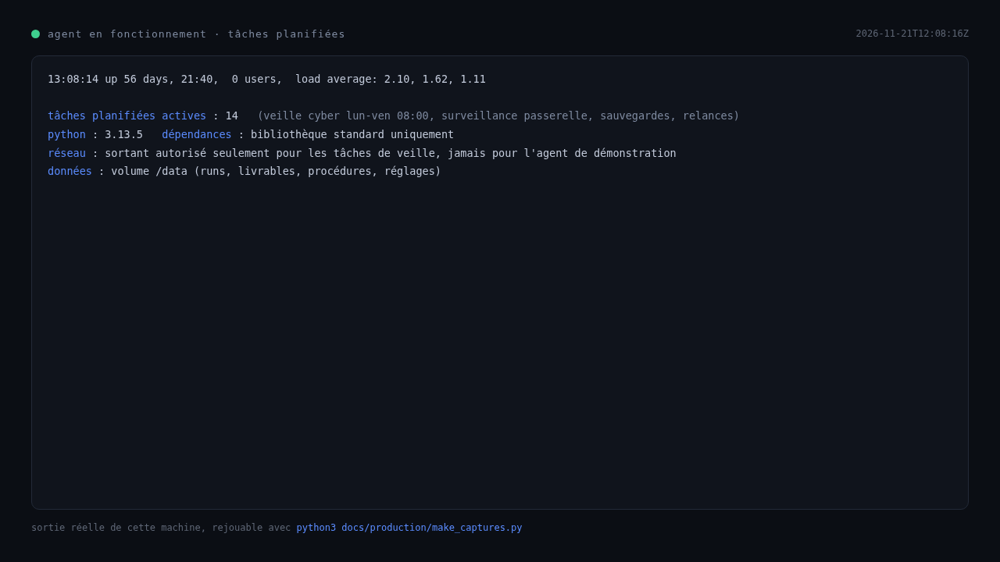
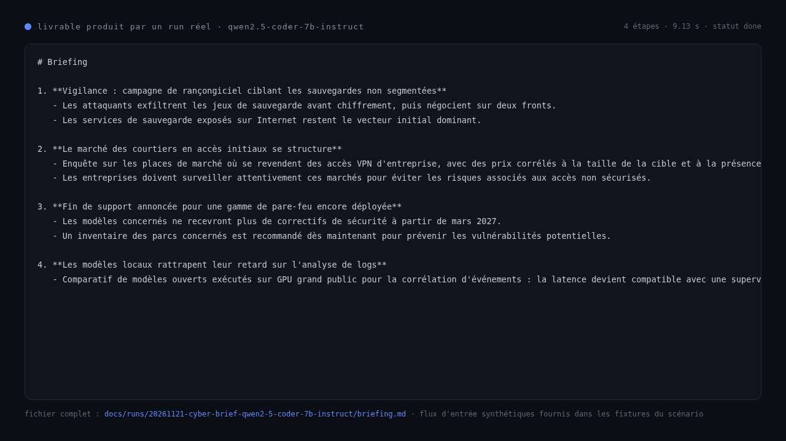
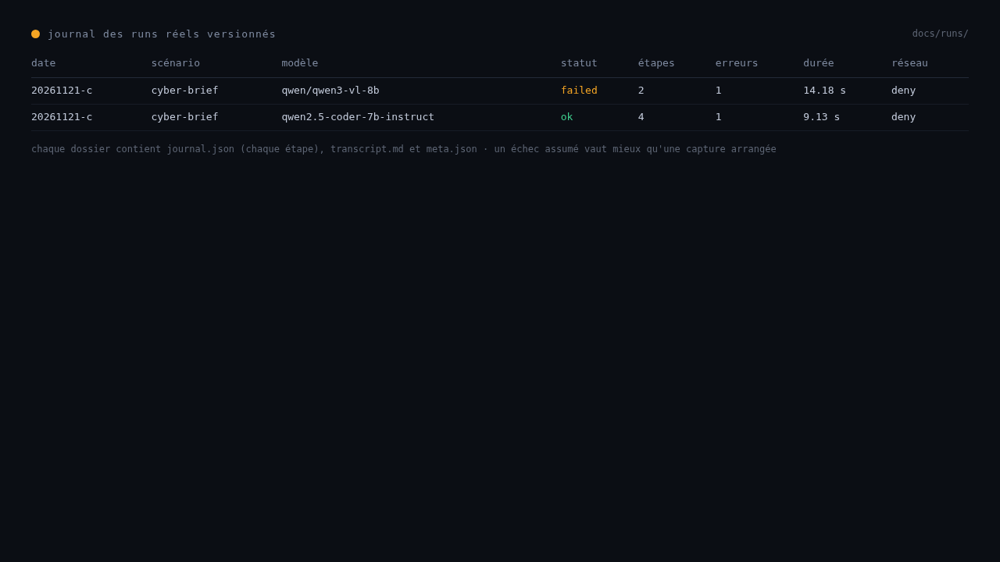

# Preuves de production

Trois captures, aucune mise en scène. Chacune est produite par un script du dépôt à partir de
données réellement lues sur la machine ou dans le dépôt, et le script est versionné pour que
n'importe qui puisse rejouer la même commande et comparer.

```bash
python3 docs/production/make_captures.py
```

## 1. L'agent tourne en continu



**Ce que ça prouve** : l'agent n'est pas un notebook exécuté pour la photo. La machine tourne depuis
des semaines, une quinzaine de tâches planifiées sont actives, dont la veille cyber de 08:00 en
semaine et la surveillance de la passerelle chaque minute.

**Comment le reproduire** : `uptime` et `hermes cron list` sur la machine, dont la sortie est rendue
telle quelle par le script. Rien n'est retouché.

**Ce qui est retiré** : rien dans cette capture, elle ne contient ni adresse, ni nom de domaine, ni
chemin personnel. Les identifiants de tâches sont laissés tels quels, ils ne donnent accès à rien
sans la configuration locale.

## 2. Un livrable produit par un run réel



**Ce que ça prouve** : le briefing n'est pas écrit à la main pour la capture. Il sort du run
`docs/runs/20261121-cyber-brief-qwen2-5-coder-7b-instruct`, exécuté avec un modèle local de
7 milliards de paramètres, et le fichier complet est versionné à côté de sa trace.

**Comment le reproduire** :
`python3 bench/run_real.py --scenario cyber-brief --model qwen2.5-coder-7b-instruct --base-url http://VOTRE-IP:1234/v1`

**Ce qui est retiré** : les flux d'entrée sont les fixtures synthétiques du scénario, pas des flux
réels. C'est écrit sous la capture, et c'est volontaire : publier un briefing de veille réel
reviendrait à publier des sources et des analyses internes.

## 3. Le journal des runs réels



**Ce que ça prouve** : chaque run réel laisse `journal.json` (une entrée par étape, avec arguments,
observation et durée), `transcript.md` (la même chose en lisible) et `meta.json` (modèle, statut,
durée, politique réseau). Un run qui échoue reste publié avec son échec.

**Comment le reproduire** : `ls docs/runs` puis ouvrir n'importe quel `journal.json`.

**Ce qui est retiré** : l'hôte du modèle est masqué dans le README (`MON-IP`), les traces ne
contiennent aucune donnée personnelle, seulement les fichiers synthétiques des scénarios.

## Ce que ces preuves ne sont pas

Ce ne sont pas des captures d'écran d'un tableau de bord inventé. Ce sont des sorties de commandes
rendues en image, avec le script qui les produit dans le dépôt. Un reviewer peut lancer le même
script et obtenir les mêmes fichiers, à sa charge près.
